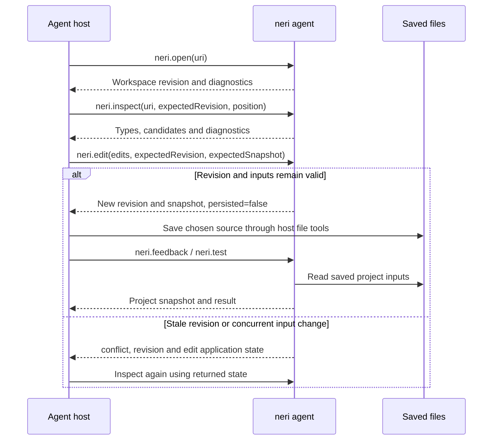

# Agent feedback

`neri agent` exposes compiler feedback to a local coding agent through MCP over
standard input and output. It keeps project source buffers in memory, analyzes
them with Neri's parser and binder, and returns diagnostics and semantic context.
Project tools inspect saved sources across declared project members. The test
tool builds and runs explicitly registered test units.

The agent host owns disk edits and commits. Compiler diagnostics describe syntax
and types, tests exercise registered behavior, and profiling measures compiler
work. Each result identifies its observed inputs.

Start one server for one project unit. MCP clients use their own configuration
shape, but a generic server entry is:

```json
{
  "mcpServers": {
    "neri": {
      "command": "/absolute/path/to/neri/scripts/neri.sh",
      "args": ["agent", "--project", "/absolute/project/root", "--unit", "app"]
    }
  }
}
```

`--project` accepts an absolute project root or manifest path. `--unit` selects
the manifest unit and is optional when project selection is unambiguous. The
stdio transport uses newline-delimited UTF-8 JSON-RPC messages. Standard output
contains protocol messages only.

## Tools

| Task | Tool | Input state |
| --- | --- | --- |
| Find declarations by name, signature or type | `neri.describe` | Saved project graph |
| Check all declared units | `neri.feedback` | Saved project graph |
| Open source and inspect types at a position | `neri.open`, `neri.inspect` | In-memory buffers |
| Preview or apply coordinated source edits | `neri.edit` | In-memory buffers, guarded by revision and snapshot |
| Build and run registered tests | `neri.test` | Saved project graph |
| Measure release compilation | `neri.profile` | Saved project graph; applications are not run |

### neri.open, neri.inspect and neri.edit

`neri.open` opens an existing source owned by the complete project graph.
The optional `text` value supplies an unsaved overlay; otherwise Neri reads the
current file. A source can have only one open buffer.

`neri.inspect` takes an open source URI, an `expectedRevision`, and a UTF-16
position. It returns the current diagnostics and, when the compiler can recover
one unambiguous completion site, the expected type, receiver context, enclosing
callable identity, and completion candidates. Candidate edits use UTF-16 LSP
ranges. `insertText` and `textEdit.newText` contain the same actual insertion;
`cursorByteOffset` is the UTF-8 byte offset of the suggested cursor within that
text.

`neri.edit` accepts `operationId`, `expectedRevision`, `expectedSnapshot` and
an `edits` array of `{uri, range, text}` replacements. The single replacement
form supplies `uri`, `range` and `text` directly and uses the same batch engine.
All affected buffers must already be open. Every range refers to the original
version of its buffer; ranges must fit complete UTF-16 scalars and must not
overlap. A batch contains at most 256 replacements.

With `preview: true`, the result contains proposed changes and diagnostics while
buffer text, versions and workspace revision remain unchanged. The compiler
analyzes each owning unit and its transitive consumers with every staged overlay
visible together. Unrelated units retain their separate source visibility.
Syntax and type errors remain reportable proposal results; they do not prevent
applying an intentional intermediate state.

The compiler checks the complete input snapshot again after analysis and polls
cancellation immediately before publishing the batch. A successful apply
advances each changed buffer once and advances the workspace revision once.
A conflict, invalid range, resource limit or cancellation publishes no buffer
changes. Results include UTF-16 edit ranges, `oldText`, `newText`,
`beforeVersion`, `afterVersion`, `snapshot`, `proposedSnapshot`, `proposalId`,
`requestDigest`, `applied` and `persisted: false`. The host owns saving files.
This is Neri's in-memory transaction contract; the LSP specification describes
related [transactional workspace edit semantics](https://raw.githubusercontent.com/microsoft/language-server-protocol/gh-pages/_specifications/lsp/3.17/types/workspaceEdit.md).

Each consumer reports diagnostic counts and a `nextCursor` when its first page
is incomplete. To retrieve another page, call `neri.edit` with `operationId`,
`expectedRevision`, `expectedSnapshot` and that `cursor`. Pages contain up to
128 diagnostics and fit the 2 MiB protocol message limit. A diagnostic that
cannot fit produces an explicit limit result without advancing its offset.
Pagination reanalyzes only the requested consumer with the proposal's overlays;
it neither applies edits nor advances the revision.

The workspace retains the latest transaction view, limited to 16 MiB of plan
text and consumer keys and 256 consumers. It releases each consumer's semantic
model before analyzing the next. Another transaction replaces the retained view.
Cursors bind the proposal, input snapshot, consumer and diagnostic offset;
changed inputs or a replaced proposal produce `conflict`. Preview cursors use
the base snapshot. Applying a proposal requires that base snapshot; the proposed
snapshot describes the resulting state.

MCP `notifications/cancelled` messages match the active request ID. The transport
also recognizes a cancellation already queued behind a future request. A bounded
64-slot queue preserves ordinary request order while analysis polls input;
queued and partially received message text share an 8 MiB polling budget.

### neri.feedback

`neri.feedback` takes an `operationId` and analyzes every unit in the root
manifest, declared `projects` members and their referenced libraries. Each unit
retains its own reference visibility and entry-point rules. A library change is
checked in every consumer's context, including consumers in other members.
Independent units remain separate. The result reports `scope: "project"`, a
snapshot, unit diagnostics, `complete`, `unitsTotal`, `unitsAnalyzed` and
`unitsReused`. `invalidatedUnits` identifies units whose input closure required
analysis; `removedUnits` identifies previously reported units absent now.

Feedback includes parser and binder errors, code style findings and unused
import hints from the same semantic tracking used by the editor. Each diagnostic
contains its source URI, code, message, UTF-16 range and explicit severity:
error `1`, warning `2`, information `3` or hint `4`, following the
[LSP diagnostic contract](https://raw.githubusercontent.com/microsoft/language-server-protocol/gh-pages/_specifications/lsp/3.17/types/diagnostic.md).
Ranges use zero-based positions and an exclusive end. Project feedback reports
advisories for sources owned by each unit; referenced sources retain their
existing compiler error reporting. Parser and binder errors determine analysis
validity. Style findings remain advisories even when their configured severity
is error; warnings and hints also preserve a valid analysis status. Diagnostic
counts and truncation include all these findings.

Snapshots include applicable ancestor `.editorconfig` files and their absence,
source contents, manifest membership, discovery directories and effective
compiler, host, runtime, code-generation and standard-library inputs. Feedback
rechecks contents and membership before publishing a result; concurrent changes
produce `conflict`. File timestamps and elapsed time do not establish validity.
Analysis reuse follows input dependencies. This separation of dependency
tracking, rebuilding and reuse is
consistent with the model in [Build systems à la carte](https://simon.peytonjones.org/assets/pdfs/build-systems-original.pdf).

On macOS and Linux, feedback shares one local persistent worker per canonical
project and effective toolchain configuration within the current user account.
The worker retains one graph, reusable unit reports and at most one semantic
document. Pages for an evicted document can reanalyze its unit under the same
input checks. Disk analysis remains independent of editor overlays. Workers
serialize requests, recycle after 256 requests and stop after 120 seconds without
a request. Transport failure uses a fresh analysis and reports
`execution.mode: "fresh-fallback"` with its cause; a persistent response reports
`execution.mode: "persistent"` and a correlated `requestId`. Platforms without
the persistent transport use the same explicit fresh fallback.

`expectedSnapshot` rejects a request for changed inputs. `pageSize` is between
1 and 128. Each response presents at most one unit with diagnostics or an actionable
state, preserving its message even when its diagnostic count is zero. Global
counts and `complete` describe analysis coverage; `nextCursor` describes remaining
presentation. An empty cursor marks the end. Cursors bind the snapshot, unit,
offset and page size. A stale cursor produces `conflict`.

Responses fit a 2 MiB byte budget. An individual diagnostic that cannot fit
produces `pageFailure` and a cursor for the same offset; it is not skipped.
The hook uses a smaller budget and includes an exact `nextCommand` to retrieve
the continuation through the CLI with the larger budget. For direct CLI paging:

```sh
neri feedback --project . --page-size 32
neri feedback --project . --page-size 32 --expected-snapshot SNAPSHOT --cursor CURSOR
```

### neri.describe

`neri.describe` takes `operationId` and a nonempty `query`. It searches bound
declarations across the project graph and returns signatures, inferred types,
documentation, identities, source URIs, UTF-16 ranges and the unit context.
Local variables and parameters stay in point inspection. The query is a
case-sensitive substring of declaration names, identities, signatures or types.
`omittedUnits` and `resultsTruncated` make incomplete coverage explicit. Results
are limited to 128 declarations and 64 KiB.

### neri.test

`neri.test` builds and executes units carrying [test metadata](PROJECTS.md)
in the root or declared member manifests. A referenced library alone does not
enroll its project's executable tests. Results include the phase, exit kind and
code, captured output, timeout failures, build snapshot and executable SHA-256.
`noTests: true` has `status: "unavailable"`. Temporary artifacts are removed
after execution. Output truncation is explicit. Test code has the host process's
filesystem and process capabilities.

### neri.profile

`neri.profile` builds all graph units with release optimization and measures
compiler phases. Libraries produce object files and executable units produce
executables. Results contain the artifact digest, input fingerprint, normal or
abnormal exit and measured durations grouped by phase with sample counts.
Frontend phases distinguish source loading, parsing, binding, IR lowering and
IR verification (`source-load`, `parse`, `bind`, `lower`, `ir-verify`).
Object-cache hit and miss events remain distinct phases. `build-complete`
measures elapsed build time; nested phases overlap, so their durations must not
be added to derive total time. Applications are not launched. A missing artifact
or incomplete timing stream produces an unavailable result. Builds have a
120-second limit per unit. This measures compiler work; application CPU, memory,
SQL and distributed tracing require runtime instrumentation.

### Shared result contracts

The project tools use disk state independently of unsaved editor overlays. They
check the complete graph again before returning and report `conflict` when its
inputs changed. The CLI exposes the same services:

```sh
neri feedback --project .
neri describe --project . --query Customer
neri test --project .
neri profile --project .
```

Every tool call requires an `operationId`, which is echoed in its result. Tool
overlay results include the canonical source URI, workspace revision, document version,
analysis status, owning-unit `projectKey`, diagnostics, and effect flags. Invalid syntax and type errors
are normal analyzed results; protocol, range, stale-revision, membership, and
resource failures have distinct statuses. Rejected edits preserve the buffer.
If external files change during analysis, a conflict response explicitly states
whether the in-memory edit was already applied; the client uses the returned
revision to inspect again.

Analyzed overlay responses include a source excerpt of at most 4 KiB, its UTF-16 range,
and an explicit truncation flag. Inspection places the excerpt around the
requested position. Clients can inspect another position to obtain more text.

### Overlay edit cycle

For a source owned by the project graph, call `neri.open` with these tool
arguments, replacing the URI with that source's absolute URI:

```json
{
  "operationId": "open-main",
  "uri": "file:///absolute/project/app/main.hk"
}
```

Use the returned workspace revision as `expectedRevision` on the next
`neri.inspect` or `neri.edit` call. Edits also use the returned `snapshot` as
`expectedSnapshot`. Positions and edit ranges count UTF-16 code units. After a conflict, use the returned state to inspect again before editing.



`neri.test` sees saved sources. A successful overlay edit alone does not change
what the test runner builds.

## Revisions and snapshots

Each tool publishes its own output schema through the
[MCP tools contract](https://modelcontextprotocol.io/specification/2025-11-25/server/tools).
Tool results expose the complete typed result in `structuredContent`. Clients
consume that object; `content.text` is a brief status summary. The summary keeps
compiler data in one representation. Preview, apply and page results are
successful tool responses; compiler-invalid analyses also remain normal results.
The transport budgets the serialized request ID and result envelope before edits
and verifies every final MCP message against its 2 MiB limit. Request IDs that
leave less than 256 KiB for a tool response are rejected before tool execution.

Malformed arguments produce an error content item without a fabricated domain
result. Compiler syntax and type diagnostics remain normal analyzed results.

The **workspace revision** is the concurrency token accepted as
`expectedRevision`. It advances when an in-memory buffer changes and when the
server observes a change to project inputs, including manifests, closed source
files, generated-source inputs, and required standard-library sources. An edit
or inspection with a stale revision returns a conflict. Opening a buffer returns
the new revision to use for the next operation.

Standard-library observation follows its manifest and every source in imported
modules, including transitive imports from additional module files.

The **document version** counts accepted in-memory changes to one open buffer.
It is descriptive; workspace revision is the mutation guard exposed by the
tools.

The **analysis revision** identifies the internal LSP analysis generation.
Invalidation and reanalysis can advance it independently of workspace revision,
so clients use it to correlate feedback, not to authorize an edit.

The **overlay snapshot** returned as `snapshot` binds the complete project graph,
compiler binary, configuration and every open buffer's URI, text and version.
Clients reuse it as `expectedSnapshot` for edits and transaction pages. Changes
to another buffer, a sibling unit's dependencies or project membership invalidate
that token. The server validates the same domain before returning or applying.

The **analysis snapshot** returned as `analysisSnapshot` hashes the analyzed
project key and that document analysis's ordered source URIs and texts. It
correlates analysis content; `expectedSnapshot` accepts the full overlay snapshot.

The **project snapshot** hashes the complete unit inventory, canonical member
identities, each unit's observed inputs and the running compiler's binary digest.
It includes source ownership, generated-source contracts, project manifests and
the imported standard-library closure. Compiler replacement invalidates cached
results even when its version string stays the same. Profiling and test artifacts
have separate binary digests. Snapshots describe observations before and after
an operation; they are not filesystem transactions or locks.

Coverage follows explicit manifest membership. Nested projects enter the graph
through `projects`; directories of negative fixtures retain their own validation
workflows. The MCP feedback reports compiler
diagnostics; it does not subscribe to Rider's inspection panel.

Complete project membership defines which files can be opened. Each
source is analyzed in its owning unit's closure, preserving the same dependency
visibility as the editor. Inspecting a library source therefore does not report
errors in its consumers; inspect the consumer source to analyze that unit with
the current library overlays.

Diagnostics come from the parser or binder for that owning compilation unit,
not only the inspected file. Each diagnostic includes its source URI, UTF-16
range, code, severity, and message. Early project, generated-source, file-name,
and standard-library failures during analysis are retained as structured
diagnostics even when editor publication is disabled. Workspace setup failures
return `unavailable` with the project loader's message before document analysis.

## Semantic context and limits

Completion context is constructed from a temporary source copy containing a
completion marker. The copy is parsed and bound with the same project sources,
visibility rules, scopes, generic inference, and expected-type rules as editor
completion. Expected types include their semantic name and kind. Symbol metadata
distinguishes the compiler's `semanticIdentity` from a canonical `identity`
anchored to a declaration in the original source. `identityStatus` reports when
that mapping is canonical, absent, or unresolved. Recovery preserves a canonical
identity only where the query offsets can be mapped back to the original text.
Argument-name contexts identify the invoked callable; other expression contexts
identify the enclosing callable when one exists.

Limited delimiter repair supports some unfinished calls. The query
does not reuse an older semantic model after project setup or parsing becomes
unavailable.

Candidates are capped at 128 within 64 KiB, and `truncated` reports when a bound
is reached. Complete context is capped at 128 KiB; larger context returns
`status: "limit"` and an empty, explicitly truncated candidate list.
Diagnostics return at most 128 entries within 64 KiB and separately report their
total count and truncation.
Input is limited to 1 MiB per document, 8 MiB across open buffers, 64 open
buffers, 1,024 observed workspace paths, 16 MiB of workspace analysis input,
and 2 MiB per MCP message.

A completion candidate is a context-sensitive suggestion, not proof that the
insertion produces a complete, valid program. The final edited unit is parsed
and bound again, and its diagnostics are authoritative. Point inspection and
buffer edits operate on in-memory source snapshots. Test execution is an
explicit `neri.test` operation; the agent host owns disk edits and commits.

## Input contracts

Tool input contracts are declared in typed descriptors. Each descriptor supplies
its public name, description, input fields and decoder. The same field structure
produces the advertised JSON Schema and validates required fields, types,
unknown properties and duplicate keys. Decoding produces a typed request whose
payload contains the fields available to that operation. Workspace execution
consumes those requests; JSON parsing and tool-name lookup belong to the protocol
boundary. Shared input limits measure source text in UTF-8 bytes, while positions
and ranges use UTF-16 code units.

The wire protocol follows the official [MCP base
protocol](https://modelcontextprotocol.io/specification/2025-11-25/basic),
[tools](https://modelcontextprotocol.io/specification/2025-11-25/server/tools),
and [stdio transport](https://modelcontextprotocol.io/specification/2025-11-25/basic/transports)
contracts.

## Reproduce the protocol contract

From a built source checkout, run the Neri contract driver against that compiler:

```sh
neri_agent_work=$(mktemp -d)
scripts/neri.sh run --project . --unit agent-protocol-contracts -- \
  "$PWD" "$PWD/build/current/bin/neri" "$neri_agent_work"
```

The driver creates a temporary project, opens two source buffers, receives a
type error, applies a repair, and queries the inferred argument type in an
unfinished expression. It also checks revision conflicts after buffer and disk
changes, UTF-16 edit boundaries, the published result schema, and MCP lifecycle
and framing behavior. Source-buffer edits remain in memory throughout the
protocol conversation.

## Automatic feedback after agent tools

`neri feedback --project ROOT [--unit UNIT] [--operation ID]` analyzes saved
sources and writes one structured feedback result to standard output. It shares
the project graph with the MCP tool and uses the current parser and binder.
An explicit `--unit UNIT` selects the single-unit feedback contract; omitting it
selects the complete graph independently of `defaultUnit`.
The command exits successfully when it delivers feedback; consumers inspect
`status` and `diagnosticCount` to distinguish valid code, invalid code and an
unavailable analysis. Invalid CLI arguments exit with status 2.

`--codex-hook` reads a bounded JSON hook event from standard input and emits the
Codex `PostToolUse` response envelope. It correlates feedback with `tool_use_id`
and places the compiler result in `hookSpecificOutput.additionalContext`. The
adapter accepts a final JSON value terminated by either a newline or EOF. A
malformed event produces explicit unavailable feedback. Diagnostic messages and
source excerpts are identified as program data in the enclosing context.

Project hook reports use `schemaVersion: 2` and `view: "diagnostics"`. Their
`units` array contains units with diagnostics, truncated diagnostics or a status
other than valid. A valid unit with zero diagnostics is represented by the
aggregate coverage counts. The report retains the snapshot, complete counts,
truncation flags, `invalidatedUnits` and `removedUnits`, so clients can identify
resolved diagnostics and removed units. Unit fingerprints remain in the full
project API and analysis cache. This compact presentation preserves every
diagnostic admitted by the normal response limits and is delivered to each new
recipient scope, including when analysis is reused.

Configure the project's `.codex/hooks.json`:

```json
{
  "hooks": {
    "PostToolUse": [{
      "matcher": "*",
      "hooks": [{
        "type": "command",
        "command": "neri feedback --project . --codex-hook",
        "timeout": 300,
        "statusMessage": "Analyzing Neri project"
      }]
    }]
  }
}
```

Set an absolute project path when tools can run from another directory. The
executable must be the built Neri version containing `feedback`.
Codex reviews and trusts hook definitions through `/hooks`; a configured hook
becomes active after the host accepts it. Neri supplies the feedback and Codex
incorporates it before the agent's next decision. The adapter responds at tool
completion boundaries, including completed editing commands.
Delivery follows the host's supported tool paths. Changes made by an external
editor are observed at the next invocation.
The hook requests a page of at most 16 diagnostics within a 16 KiB feedback
budget. Aggregate status, coverage, diagnostic count and snapshot accompany the
page. `nextCursor` and `nextCommand` preserve access to later diagnostics. Host
preview limits remain independent of this byte budget and the JSON envelope.

Optional `--state FILE` enables deduplication for hook invocations. The parent
directory must exist. A bounded delivery ledger records up to 64 recipient
scopes with their snapshot and page identity. Alternating recipients retain their
delivery records: an unchanged page previously delivered to the same recipient
emits `{}`, while a new recipient receives its first page. Eviction or missing
recipient identity permits repeat delivery. Recipient scopes include the host
session, turn and transcript. Project-analysis reuse belongs to the persistent
service and remains independent of delivery records.
On macOS and Linux, invocations sharing a canonical state path serialize analysis
with a process-owned OS lock. Each waiter reads the latest delivery ledger after
acquiring the lock and requests feedback for the current disk snapshot. The
stable `FILE.lock` remains on disk; the OS releases ownership when the analyzing
process exits or crashes. Delivery records are written under this lock before
delivery. Missing or unreadable records permit repeat delivery.
Windows project feedback uses fresh analysis without this serialization optimization.
The input identity includes
project and unit selection, compiler version and executable digest, the canonical standard-library
location, its manifest and required sources, and observed project inputs.
The persistent project worker retains reusable per-unit results.
When one input closure changes, unaffected units reuse their recorded results.
Each graph pass shares bounded file-content, digest and import observations
across units. Verification reads disk again. Project
feedback brackets analysis and page construction with input checks; standalone unit feedback
performs its own input checks. Diagnostics use the complete parser and binder
without recording editor navigation symbols. Inspection and documentation retain
their semantic symbol indexes.
The response identifies reused units and keeps explicit continuation state.
Standalone unit feedback retains version 2 state records with an integrity digest
over scope, inputs and report. This digest detects accidental corruption and does
not authenticate a writer with access to the state file.

State writes concern only this cache. `effects.persisted` describes source-file
persistence and remains false. A missing, partial or unwritable cache causes
repeat feedback. Only consistent `valid` or `invalid` analyses populate the
cache. Analysis checks its inputs again before returning; concurrent changes
produce `conflict`. Each result describes the observed snapshot, and subsequent
edits require another analysis. The hook analyzes the complete project graph by
default. Test execution and profiling are explicit tools; source analysis alone
does not assert that tests passed or that application performance was measured.

The adapter follows the official [Codex hook contract](https://learn.chatgpt.com/docs/hooks).
The separation of analysis and host delivery also permits other clients to use
MCP or the plain JSON command. MCP resource subscriptions are an optional
transport facility; [the MCP resource contract](https://modelcontextprotocol.io/specification/2025-11-25/server/resources)
leaves context incorporation to the host application.

[Reflexion (Shinn et al., 2023)](https://arxiv.org/abs/2303.11366) studies the use
of task feedback across agent attempts. Together with SWE-agent's interface
study, it motivates the edit/analyze/repair cycle. Protocol tests establish
Neri's feedback delivery and revision behavior; agent task-success improvements
require a separate evaluation.

The integration contract can be reproduced with:

```sh
neri_feedback_work=$(mktemp -d)
scripts/neri.sh run --project . --unit agent-feedback-contracts -- \
  "$PWD" "$PWD/build/current/bin/neri" "$neri_feedback_work"
```

It exercises disk errors and repairs, consumer diagnostics after dependency
changes, overlay isolation, hook delivery and deduplication, and changes in an
additional source of a standard-library module. The MCP protocol contract also
checks the published feedback schema and preservation of overlay revisions.
